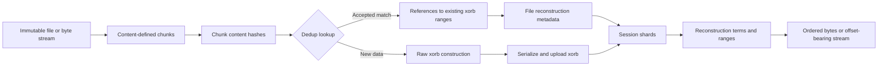

# Xet Architecture for HF Drive Agents

Source basis: the installed **1.8.1** crates in
`C:/Users/momo-/.cargo/registry/src/index.crates.io-1949cf8c6b5b557f/`, plus HF Drive's vendored `xet-client` transport-budget patch in `vendor/xet-core/`.

This is a source audit, not a claim of live-CAS acceptance. **Fact** describes code behavior; **Derived** identifies a consequence or missing guarantee; **Guidance** is an HF Drive integration decision, not an upstream promise.

## 1. Crate boundaries and end-to-end flow

| Crate | Responsibility |
|---|---|
| `xet-core-structures` | Merkle identities, xorb/chunk/footer formats, shard binary records and lookup validation |
| `xet-data` | Content-defined chunking, dedup, xorb/shard construction, reconstruction sessions |
| `xet-client` | CAS HTTP clients, grant/commit upload, reconstruction queries, signed-URL term retrieval, retries |
| `xet-runtime` | Configuration, runtime resources, semaphores, caches, telemetry and system monitoring |
| `hf-xet` | `XetSession`, upload commits, download groups, ordered/unordered streams, cancellation and public errors |

`hf-xet` composes the other crates rather than replacing their responsibilities (`hf-xet/README.md`).

**Important durability boundary:** file ingestion completion, xorb upload, shard finalization, and application bucket/HEAD publication are different milestones. `upload_files` does not itself finalize the session; finalization joins xorb uploads before shard upload (`xet-data/src/processing/file_upload_session.rs:195-298,702-748`). No bucket binding, ETag replacement, or rollback protocol is implied by those steps.

## 2. Identity domains: do not mix them

| Identity | Construction and meaning | Critical distinction |
|---|---|---|
| Chunk hash | `compute_data_hash` over **uncompressed chunk bytes** | Not generic SHA-256 and not a hash of compressed bytes |
| Xorb hash | Aggregated root of ordered `(chunk hash, uncompressed size)` pairs | Not a file Merkle hash or a hash of the serialized xorb |
| File Merkle hash | `file_hash_with_salt(chunks, salt)`; zero salt for `file_hash` | Separate from xorb identity and optional SHA-256 |
| Range-verification hash | `range_hash_from_chunks` for a selected chunk range | Not the xorb root, file SHA-256, or an S3 ETag |
| SHA-256 extension | Optional metadata in file records | An application digest; not a Merkle identity |
| Shard hash | Hash of the complete serialized shard | Depends on serialized bytes, including permitted metadata choices |
| S3 ETag | External object-store publication validator | Never use it as a Xet/CAS identity |

Leaf and internal hashes use distinct fixed-key BLAKE3 domains (`xet-core-structures/src/merklehash/data_hash.rs:263-296,299-322`). Internal nodes hash textual `"<hash_hex> : <decimal_size>\n"` entries and sum sizes; aggregation uses 2–9 children and repeats until one root (`xet-core-structures/src/merklehash/aggregated_hashes.rs:2-15,36-49,94-157`). `file_hash_with_salt` applies the salt to the root; empty input yields the default hash (`aggregated_hashes.rs:172-193`).

Xorb identity does not depend on compression selection or the footer uniqueness nonce. A four-byte prefix of the footer nonce can change serialized bytes without changing the content root (`xet-core-structures/src/xorb_object/xorb_object_format.rs:34-47,367-373,1112-1119,1155-1162`). Consequently, **serialized-byte equality is not content-identity equality**. Validate the xorb structure and hash instead.

The optional shard metadata extension carries a separate `sha256` (`metadata_shard/file_structs.rs:18-20,285-305`). Keep every identity type separate in application code.

## 3. Chunking and xorb/shard formats

### 3.1 Content-defined chunks

The default CDC target is **64 KiB**. The recommended minimum is target/8 (8 KiB), and the forced maximum is target×2 (128 KiB). Small files and final chunks may be smaller. A xorb is limited to **64 MiB and 8192 chunks** (`xet-core-structures/src/xorb_object/constants.rs:1-25`).

`Chunker::new` requires a power-of-two target greater than 64 and below `u32::MAX`; it constructs a gear-hash mask and allocates its pending buffer at maximum-chunk capacity (`xet-data/src/deduplication/chunking.rs:30-62`). Boundary detection uses a 64-byte gear-hash window, accepts matches after the minimum, and forces a boundary at the maximum (`chunking.rs:76-140`). `find_partitions` can locate aligned partitions for parallel chunking, but ordinary `upload_files` parallelizes **across files**, not by invoking that helper (`chunking.rs:270-355`; `xet-data/src/processing/file_upload_session.rs:195-298`).

**Memory fact:** common chunks can be `Bytes::slice` views of an ingestion block, while chunks crossing an input boundary are copied into `chunkbuf`. Retaining a slice can retain its whole owner; pending raw xorbs, compression/serialization and queued uploads add more memory (`xet-data/src/deduplication/chunking.rs:214-264`). Do not estimate memory as only `files × ingestion_block_size`.

### 3.2 Chunk encoding

`XorbChunkHeader` is eight bytes: one version byte, three little-endian compressed-length bytes, one compression-scheme byte, and three little-endian uncompressed-length bytes. Payload length follows the header (`xet-core-structures/src/xorb_object/xorb_chunk_format.rs:10-20,91-96,99-109,169-188`).

`CompressionScheme::Auto` is resolved before writing. Non-shrinking output—including equal length—is stored as `CompressionScheme::None` (`xorb_chunk_format.rs:112-138`). Header parsing rejects unknown schemes, unsupported versions, compressed lengths above `2 * MAX_CHUNK_SIZE`, and uncompressed lengths above `MAX_CHUNK_SIZE` (`xorb_chunk_format.rs:60-88`).

**Derived limitation:** producer-side setters and `serialize_chunk` do not replace those consumer checks with a general release-mode size policy. Enforce chunk and aggregate bounds before serialization; the header's three-byte length is not an application allocation budget (`xorb_chunk_format.rs:64-88,99-102,112-138`).

Decoding verifies decompressed output length but does not recompute the chunk hash (`xorb_chunk_format.rs:156-188`). Multi-chunk decoding distinguishes a clean boundary EOF from truncation and returns uncompressed boundary indices (`xorb_chunk_format.rs:218-255`).

### 3.3 Xorb layout

A complete xorb is ordered chunks, a V1 footer, then a four-byte little-endian `info_length` allowing a seekable reader to locate the footer (`xet-core-structures/src/xorb_object/xorb_object_format.rs:915-936,948-982,1012-1024`). V0 is marked “DO NOT USE in any new code”; new output uses V1 (`xorb_object_format.rs:20-30,61-63,294-304`).

V1 includes the xorb hash, chunk hashes, physical end offsets and unpacked end offsets. The boundary vectors omit the initial zero (`xorb_object_format.rs:295-373,330-359`). V0 deserialization may leave unpacked offsets empty, while normal V1 serialization expects all three vectors to contain `num_chunks` entries (`xorb_object_format.rs:516-539,838-858,434-497`). Do not treat converted V0 data as a complete V1 value without reconstructing that information.

Range helpers translate nonempty end-exclusive chunk ranges to physical offsets and return uncompressed bytes (`xorb_object_format.rs:1202-1225,1234-1272`). Boundary-only reads avoid loading chunk hashes, but directly resize vectors from serialized counts (`xorb_object_format.rs:639-704`). Untrusted input still needs a count/size budget.

### 3.4 Shard layout and lookup

Shard sections are file-info records, xorb-info records, file lookup, xorb lookup, chunk lookup, and a footer. File/xorb lookup entries use a truncated hash plus a `u32` record index; chunk lookup adds xorb-block and chunk-offset indices. Lookup tables are sorted by truncated hash (`xet-core-structures/src/metadata_shard/shard_format.rs:21-31,102-131,252-284,307-360,377-465`).

File size is the sum of segment **unpacked** sizes, not serialized xorb size (`metadata_shard/file_structs.rs:359-368`). A xorb record stores chunk count, unpacked bytes and on-disk bytes; each chunk entry carries hash, unpacked start, length and flags (`metadata_shard/xorb_structs.rs:13-20,77-85,173-215`).

File lookup checks the complete file hash after truncated-index candidates; multiple candidates can produce `TruncatedHashCollision` (`metadata_shard/shard_format.rs:479-548,648-666,733-758`). HMAC-configured dedup matching transforms query hashes with the shard key but does not encrypt content or establish authorization (`metadata_shard/shard_format.rs:467-477,602-610`).

## 4. Ingestion and deduplication

### 4.1 Pipeline and source coherence

`FileUploadSession` provides file, byte and caller-driven streaming uploads. The ordinary path reads bounded ingestion blocks, computes chunks and optional SHA-256 on blocking work, deduplicates, constructs pending raw xorbs, serializes/uploads them, then finalizes file reconstruction metadata (`xet-data/src/processing/file_upload_session.rs:195-298,409-507,702-748`).

The ordinary reader assumes the captured file size does not change while reading. It does not lock the source or take an immutable snapshot (`file_upload_session.rs:203-268`). `spawn_upload_from_path` instead uses a reusable read buffer, and `SingleFileCleaner::add_data` copies supplied slices into `Bytes` (`file_upload_session.rs:334-352,389-405`; `processing/file_cleaner.rs:138-140`).

**HF Drive guidance:** upload immutable staged snapshots. The SDK is not a coherence guard against an in-place editor or atomic replacement.

Task creation is not equivalent to active-work bounding: `upload_files` creates a complete task vector before joining it, while each task acquires the file-ingestion semaphore (`file_upload_session.rs:195-235,286-297`). Very large input lists still allocate many task objects; batch above the SDK.

### 4.2 Dedup order and outcomes

Per-batch dedup queries session/resumed/cache shard state first, then an optional caller `DeduplicationSource` (`xet-data/src/processing/deduplication_interface.rs:36-54`; `processing/shard_interface/native.rs:172-199`). Eligible misses can trigger global shard discovery using first-chunk or configured eligibility, spacing and first-pass rules. A second pass runs only if new shard information arrived; at most two passes occur (`xet-data/src/deduplication/file_deduplication.rs:114-190`).

The default spacing is 256 chunks, not a queries-per-second rate (`xet-runtime/src/config/groups/data.rs:7-14`; `xet-data/src/deduplication/file_deduplication.rs:157-175`). Native global lookup failures are logged and treated as no new shard, allowing new data to proceed rather than failing ingestion solely because optimization was unavailable (`processing/shard_interface/native.rs:154-170`).

| Situation | Payload behavior | Metadata/other consequence |
|---|---|---|
| Accepted session/cache/global match | No new payload for that matched range | File segment and xorb dependency retained |
| Match in current pending xorb | No duplicate in that pending xorb | Marker resolves to the eventual xorb hash |
| Defrag policy rejects a match | Known bytes become new data | Prevented-dedup metrics are recorded separately |
| External `DeduplicationSource` match | This session sends no matched payload | Caller owns persistence, lifetime and later transfer |
| Fully deduplicated file | Zero new xorb payload is possible | File/shard reconstruction metadata is still finalized |
| Reconstruction terms share an xorb block | Single-flight download once | Later terms reuse the in-memory result |

Sources: `file_deduplication.rs:191-306,374-409`; `file_upload_session.rs:50-60,424-443,1075-1088`; `file_reconstruction/reconstruction_terms/xorb_block.rs:90-181`.

Defrag prevention may deliberately retransmit known content to avoid fragmented reconstruction (`file_deduplication.rs:202-249`). A full payload match therefore does not imply zero wire traffic, and full payload dedup does not remove the shard metadata write.

### 4.3 Xorb aggregation and upload

Pending new data is cut before exceeding byte/chunk limits. `RawXorbData::from_chunks` retains chunk-backed bytes, per-chunk hash/length/offset metadata, and an xorb hash from ordered pairs (`xet-core-structures/src/xorb_object/raw_xorb_data.rs:18-61`). Marker references resolve when that xorb is cut (`file_deduplication.rs:339-372`).

Residual data from multiple files is packed into session-level aggregates while respecting xorb limits (`file_upload_session.rs:509-573,610-642`). For each new xorb, the session registers dependency state, adds metadata for future dedup, serializes on a blocking thread, acquires an upload permit, and spawns upload (`file_upload_session.rs:409-507`).

**Memory limitation:** xorb serialization happens **before** `acquire_upload_permit` (`file_upload_session.rs:452-480`). Client upload permits therefore do not bound serialized objects waiting for permits; application admission must cover that queue too. Xorbs are serialized without a footer in this path (`file_upload_session.rs:452-466`).

### 4.4 Finalization and resume

Finalization cuts residual aggregates, joins all xorb tasks, then flushes/consolidates/uploads/registers session shards (`file_upload_session.rs:702-748`). Native shard upload acquires permits **before** spawning each task, limiting shard-task/memory growth (`processing/shard_interface/native.rs:248-290`).

`UploadShardCachePolicy::Skip` is required for local/staging clients whose writes do not prove remote availability. `Populate` exports successful shards to the shared cache and registers them; dry-run does not upload or move shards to cache (`processing/shard_interface/native.rs:286-337`, `file_upload_session.rs:38-52`).

Native resume metadata defaults to a 20-second or 64-xorb flush interval. Valid staging shards can make later sessions treat those xorbs as uploaded; obsolete staging is removed only after final work succeeds (`processing/shard_interface/native.rs:55-147,208-235,344-360`; `xet-runtime/src/config/groups/data.rs:72-86`). Wasm uses materially different persistence and uploads session shards from memory (`processing/shard_interface/wasm.rs:137-180`).

**Finalization is one-shot.** A failed finalize cannot simply be retried on the same session; use a new session and validated resume state (`file_upload_session.rs:657-674,779-783`). It is not a remote transaction with rollback: successful xorbs can already exist when shard publication fails (`file_upload_session.rs:62-68,409-507,702-748`).

## 5. CAS protocol and HTTP behavior

### 5.1 Main routes

| Operation | Flow and evidence |
|---|---|
| Global dedup lookup | `GET /v1/chunks/{prefix}/{chunk_hash}`; a shard body on success, 404 as cache miss (`xet-client/src/cas_client/remote_client.rs:169-213`) |
| Xorb grant request | `POST /v1/xorb-grants/{prefix}/{xorb_hash}` with `{length, checksum}`; 201 grants, 200 means existing xorb, 404 means grants unavailable (`remote_client.rs:470-535`) |
| Grant-URL upload | Server-supplied method/URL/headers; 412 means prior storage, 409 is retried (`remote_client.rs:537-625`) |
| Grant commit | `POST /v1/xorb-commits/{prefix}/{xorb_hash}/grant/{grant_id}`; 404 means no uploaded data (`remote_client.rs:633-670`) |
| Direct xorb upload | `POST /v1/xorbs/{prefix}/{xorb_hash}`; decodes `UploadXorbResponse.was_inserted` (`remote_client.rs:305-367`) |
| Reconstruction | `GET /v1/reconstructions/{file_id}` or `/v2/reconstructions/{file_id}`; optional standard `Range`, V2 with V1 fallback on 404/501 (`remote_client.rs:675-794`) |
| Batch reconstruction | `GET /v1/reconstructions?file_id=...&file_id=...`; no client-side batch-size bound or response-completeness check here (`remote_client.rs:997-1029`) |
| V1 shard upload | `POST /v1/shards`; `Exists` or `SyncPerformed`, optionally authoritative stored hash (`remote_client.rs:797-841`) |
| V2 shard upload | `POST /v2/shards`; NDJSON terminal `result`/`error`, native only (`remote_client.rs:844-930`; `shard_upload_v2.rs:9-105`) |
| Dirty-window query | `GET /v2/file-chunk-hashes/{file_id}` with `X-Range-Dirty`; chunk-aligned dirty windows and opaque gap subtrees, not per-chunk hashes (`interface.rs:98-110`; `remote_client.rs:1395-1435`) |
| Signed-URL term data | URL from `URLProvider`, one or multiple HTTP ranges; returns decompressed bytes and chunk indices (`interface.rs:30-39`; `remote_client.rs:1041-1194`) |

The public `Client` trait does **not** provide bucket keys, OAuth, S3 ETags, publication, persisted resume state, or cancellation tokens (`xet-client/src/cas_client/interface.rs:30-111`). Those belong to higher layers/application code.

### 5.2 Grant upload sequence

Grant-first upload is:

1. Serialize the xorb and compute CRC64-NVME over the **serialized bytes**.
2. Request a grant with length/checksum.
3. If the grant response is 200, avoid payload upload.
4. Otherwise upload to the supplied URL/method/headers.
5. Commit the grant through authenticated CAS.
6. Regrant on grant-URL 400/403, exhausted 409 retries, or grant-not-found; after the grant-attempt limit, fall back to direct upload.
7. Grant/commit CAS errors themselves propagate rather than silently falling back (`remote_client.rs:253-256,381-467`).

Grant IDs are URL-encoded; empty, `.` and `..` IDs are rejected before constructing the commit URL (`remote_client.rs:634-653`).

Grant upload uses the client without CAS bearer middleware. It applies grant-supplied headers and `Content-Length` when needed (`remote_client.rs:543-616`). **Security caveat:** both authenticated and unauthenticated clients can receive shared custom headers, so do not put Hub/OAuth/S3 secrets in a CAS-wide custom header map and assume the grant/CDN path cannot see them (`remote_client.rs:90-127`; `common/http_client.rs:112-116,193-216`).

A grant 412 is a xorb dedup result, not an HF Drive bucket-HEAD compare-and-swap operation.

### 5.3 Reconstruction and ranges

`FileRange` is start-inclusive/end-exclusive; `HttpRange` is start/end-inclusive, so conversion subtracts one from the exclusive end (`xet-client/src/cas_types/mod.rs:64-68,92-123`). Reconstruction uses V2 when available, with automatic V1 fallback on 404/501 (`remote_client.rs:675-794`).

A 416 is expected and converted to `Ok(None)` without retry; other errors propagate, except that V2 404/501 triggers V1 (`remote_client.rs:675-735,756-794`).

`URLProvider` supplies a URL and range(s), with `refresh_url` for 403 handling. The term fetch emits one or multiple ranges and deserializes the returned xorb data (`interface.rs:30-39`; `remote_client.rs:1041-1103`).

Multipart responses are buffered completely, split by `Content-Range` start, and each part is deserialized independently. Nonmultipart responses also accumulate decompressed output before returning `Bytes` (`remote_client.rs:1110-1189`; `cas_client/multipart.rs:12-66`).

**Do not infer exact-wire-range guarantees.** The code does not require status 206 or prove that the returned parts equal the requested ranges, total object size, or each `Content-Range` length. The multipart parser has no general size bound (`cas_client/multipart.rs:12-121`). Reconstruction ranges and application byte ranges are different things.

### 5.4 Shard upload versions and completion

V1 submits the full shard body and returns `Exists` or `SyncPerformed`, with optional authoritative stored hash. Native V1 deliberately uses a separate client with no read timeout because server validation can remain silent (`remote_client.rs:797-841`; `common/http_client.rs:120-158`).

V2 streams the request and requires an NDJSON terminal success frame:

- frames are limited to 1 MiB excluding newline;
- `validating`/`committing`/unknown events are nonterminal;
- `result` is success;
- `error { retryable: true }` retries the whole upload;
- malformed JSON, oversized frames and EOF without a terminal frame are fatal;
- HTTP 200 alone is not success (`xet-client/src/cas_client/shard_upload_v2.rs:9-105`).

V2 is preferred and falls back only on 404/501; successful version detection is cached per `RemoteClient`, while failures do not poison that cache (`remote_client.rs:756-794,936-982`). The server re-serializes shards, so an authoritative returned V1 hash must be used when present; V2 returns no stored hash and older V1 servers may omit it (`interface.rs:80-94`; `remote_client.rs:953-963`). Never silently substitute a locally predicted hash.

### 5.5 Retry, timeout and cancellation boundaries

`RetryWrapper` recreates the request and response processing from the beginning; it is not byte-offset resume (`xet-client/src/cas_client/retry_wrapper.rs:319-429`). Default classifications:

- 5xx, 408 and 429 are transient;
- other 4xx are fatal;
- 501 is explicitly permanent despite being 5xx;
- 403 and 409 are retried only where enabled;
- 412 is special success only for grant upload;
- dedup disables 429 retry (`retry_wrapper.rs:240-300,573-589`).

Exponential backoff has jitter. `retry_max_duration` limits each sleep, **not total elapsed retry time** (`retry_wrapper.rs:340-350,552-568`). No general `Retry-After` parser is present in this path.

Runtime defaults are five retries, 3-second base delay, 6-minute per-sleep cap, 60-second connect timeout, 300-second received-data timeout, 60-second idle-pool timeout and 16 idle connections per host. Upload reporting blocks default to 512 KiB (`xet-runtime/src/config/groups/client.rs:6-92`). The reporting block is not a CDC chunk size, xorb size, resume quantum or rate limiter.

The `Client` operations do not accept cancellation tokens (`interface.rs:45-111`; `shard_upload_v2.rs:17-66`). Higher layers must cancel/drop the whole future, including permit acquisition, token refresh, URL refresh, request send and response processing. Cancellation or retry exhaustion is not proof that CAS rejected an upload: retries can reissue whole POSTs and server processing may already have begun. Reconcile remote state rather than treating cancellation as rollback.

## 6. Reconstruction sessions and integrity

### 6.1 Download flow

`FileDownloadSession` supports whole files, writers, ordered streams and unordered `(offset, Bytes)` streams, with range variants (`xet-data/src/processing/file_download_session.rs:126-207,327-419`; `file_reconstruction/file_reconstructor.rs:207-245`).

Reconstruction terms map output ranges to xorb chunk ranges. Terms for the same xorb block share a `OnceCell` download: the first caller obtains a permit and fetches; concurrent callers share the result; failure leaves the cell empty for retry (`file_reconstruction/reconstruction_terms/xorb_block.rs:54-83,90-181`).

Each term acquires a buffer permit, fetches data, translates its range relative to the requested range start, and passes it to the writer (`file_reconstructor.rs:344-431`). The target buffer is `min(base + active_downloads × per_file, limit)`, with a seed permit for new work and a guard that shrinks the target on exit (`file_reconstructor.rs:307-340`).

Ordered output waits for scheduled writes; unordered streams trade order for completion-order offsets (`file_reconstructor.rs:125-205,227-245,432-453`).

**HF Drive range rules:**

- Half-open ranges are used; an inclusive application end must be converted explicitly (`file_download_session.rs:422-460`).
- Known-size stream reconstruction clips end to file size and caps start to that clipped end (`file_reconstructor.rs:291-296`).
- Unordered stream offsets are relative to the reconstruction output, not necessarily absolute original-file offsets; add the original range start when writing a full-file image (`file_reconstructor.rs:342-343,419-427`; `data_writer/unordered_download_stream.rs:172-181`).
- `download_to_writer` computes expected length from the original bounded range while the reconstructor clips EOF. Pre-clip bounded writer requests to avoid `SizeMismatch` (`file_download_session.rs:399-418`; `file_reconstructor.rs:291-296`).

### 6.2 Integrity layers, not one universal guarantee

| Layer | Established behavior | What it does not prove |
|---|---|---|
| Chunk identity | Content hash used for dedup and Merkle construction (`xet-core-structures/src/xorb_object/chunk.rs:8-17`) | That the file's output was rehashed on download |
| Xorb identity | Ordered chunk hash/length aggregation (`raw_xorb_data.rs:35-50`) | A final whole-file SHA-256 check |
| File identity | File chunk-list Merkle root (`file_deduplication.rs:412-418`) | An application SHA-256 or S3 ETag |
| Segment verification entries | `range_hash_from_chunks` stored per segment (`file_deduplication.rs:420-449`) | That download output was rehashed |
| Term decode | Structural parsing and optional expected uncompressed length checks (`remote_client.rs:1130-1205`; `file_reconstruction/reconstruction_terms/file_term.rs:278-284`) | A full-file digest for every range |
| Final byte count | Whole-file/writer downloads compare reconstructed and expected sizes (`file_download_session.rs:353-368,399-418`) | Same-length content correctness |
| Whole xorb validation | Recomputed chunk hashes, boundaries, footer adjacency and xorb root (`xorb_object_format.rs:1079-1162`) | File metadata, outer SHA-256, or remote availability |

`FileReconstructor::run_impl` does not compare a final whole-file SHA-256 or Merkle hash before success. Completion is writer completion plus debug-only assertions (`file_reconstructor.rs:404-453`). For end-to-end HF Drive verification, hash the completely materialized immutable version independently. A known whole-file SHA-256 does not authenticate arbitrary unverified partial ranges.

`Sha256Policy::Provided` trusts a supplied digest rather than recomputing it; `Compute` calculates it and `Skip` omits the extension (`processing/file_cleaner.rs:22-54,90-113,225-256`). Treat an untrusted provided digest as metadata requiring independent verification.

### 6.3 Whole-xorb validation

`validate_xorb_object` performs full chunk decode, hash recomputation, physical/V1 boundary checks, footer adjacency and xorb-root comparison against both the footer and caller-supplied expected hash (`xorb_object_format.rs:1079-1162`). Its result is three-valued: `Ok(Some(object))`, `Ok(None)` for rejected format/hash/boundary paths, and `Err` for propagated I/O/other errors (`xorb_object_format.rs:1079-1108,1118-1162`). Handle all three; footer deserialization alone is not integrity proof.

## 7. Configuration, concurrency, caches, and resource limits

### 7.1 Programmatic configuration and scope

`XetConfig::default()` is the environment-independent starting point. `XetConfig::new()` applies a high-performance preset, `HF_XET_*` overrides, telemetry opt-outs and reconstruction-buffer normalization (`xet-runtime/src/config/xet_config.rs:31-46,142-159`; `config/groups/telemetry.rs:4-20`). `with_config("group.field", value)` validates one dotted key; `get`/`all_keys` use the same names (`xet_config.rs:17-24,50-62,91-136,196-201`).

For deterministic application behavior, use `XetConfig::default()`, apply `with_config`, and pass it through `XetSessionBuilder::new_with_config` (`hf-xet/src/xet_session/session.rs:127-140,192-215`). The builder does not add environment overrides to that supplied configuration.

Every build creates a fresh `XetContext`, even when sessions share a Tokio runtime (`hf-xet/src/xet_session/session.rs:172-180,192-215`; `xet-client/src/cas_client/adaptive_concurrency/cache.rs:1-41`). CAS controllers are additionally partitioned by direction, endpoint and context. **Provider-wide fairness and a single scheduler across drives are not supplied by Xet.**

### 7.2 Important defaults and actual scope

| Setting | Default / meaning | Scope and limitation |
|---|---|---|
| `data.max_concurrent_file_ingestion` | 8 files | One `XetContext`, not process-wide |
| `data.max_concurrent_file_downloads` | 8 files | One `XetContext`; `download_file_background` uses it, stream/writer constructors do not automatically acquire it (`file_download_session.rs:133-138,327-340,381-392`) |
| `data.ingestion_block_size` | 8 MB decimal | Ingestion read-block size, not total upload memory |
| `client.retry_max_attempts` | 5 | Request retries, not total elapsed-time cap |
| `client.retry_base_delay` | 3000 ms | Exponential backoff with jitter |
| `client.retry_max_duration` | 360 s | Per-sleep cap, not total retry deadline |
| `client.connect_timeout` | 60 s | Connection establishment only |
| `client.read_timeout` | 300 s | Received-data interval, not total transfer deadline |
| `client.max_idle_connections` | 16 | reqwest `pool_max_idle_per_host`, not process-wide connection cap |
| `client.upload_reporting_block_size` | 512 KiB | Progress/reporting granularity, not CDC chunk size or rate limit |
| `client.max_xorb_grant_attempts` | 3 | Grant attempts before direct fallback |
| `client.ac_max_upload_concurrency` | 64 streams | Adaptive upload controller per endpoint/context |
| `client.ac_max_download_concurrency` | 64 streams | Adaptive download controller per endpoint/context |
| `client.ac_initial_upload_concurrency` | 2 streams | Initial adaptive upload bound |
| `client.ac_initial_download_concurrency` | 4 streams | Initial adaptive download bound |
| `shard.cache_size_limit` | 16 GB decimal; **soft** | Pruned on load/refresh; running sessions can exceed it (`metadata_shard/shard_file_manager.rs:274-306`) |
| `shard.chunk_index_table_max_size` | 64 * 1024 * 1024 **entries** | Dedup index policy, not byte limit or disk cap |
| `chunk_cache.size_bytes` | 10,000,000,000 bytes; `0` with `no-default-cache` | Optional lower-level chunk cache, not automatic high-level range cache |
| `reconstruction.download_buffer_size` | Memory-derived; fallback 2 GB | Base reconstruction buffer, not process memory cap |
| `reconstruction.download_buffer_perfile_size` | Memory-derived; fallback 512 MB | Per active-file increment |
| `reconstruction.download_buffer_limit` | Memory-derived; fallback 8 GB | Buffer limit, not network-rate limit |
| `reconstruction.min_reconstruction_fetch_size` | 256 MB | Minimum reconstruction term, not a byte-rate budget |
| `reconstruction.max_reconstruction_fetch_size` | 8 GB | Maximum reconstruction term |
| `reconstruction.min_prefetch_buffer` | 1 GB | Minimum speculative read-ahead |
| `reconstruction.target_block_completion_time` | 900 s | Prefetch target, not timeout |
| `telemetry.max_in_flight` | 32 | Process-wide telemetry request cap; excess documents dropped |
| `system_monitor.enabled` | `false` | Optional system-wide telemetry, not Xet-only wire accounting |

Sources: `xet-runtime/src/config/groups/data.rs:23-37`, `client.rs:6-92,215-250`, `shard.rs:4-30`, `chunk_cache.rs:1-10`, `reconstruction.rs:7-88`, `telemetry.rs:62-77`, `system_monitor.rs:6-21`.

**There are no general upload/download bytes-per-second limiters, token buckets, staging-admission limits, minimum-free-space settings, independent metadata concurrency settings, or a `range_cache_bytes` setting in the complete configuration registry** (`xet-runtime/src/config/macros.rs:1-11` and the tables above). Those are application policies.

### 7.3 Adaptive concurrency and semaphores

Adaptive increases add a stream only when observed health, minimum bytes/transmissions, adjustment delay and predicted RTT allow it. Failures or poor health decrease concurrency subject to bounds and timing (`xet-client/src/cas_client/adaptive_concurrency/controller.rs:427-568`).

`client.enable_adaptive_concurrency` exists, but current transfer constructors call `new` unconditionally with `adjustment_disabled: false`. Only `new_fixed` disables adjustment. For fixed limits, set initial = minimum = maximum or use the fixed aliases; do not rely on `HF_XET_CLIENT_ENABLE_ADAPTIVE_CONCURRENCY=false` (`xet-client/src/cas_client/adaptive_concurrency/controller.rs:298-340,347-373`).

`AdjustableSemaphore` decreases are lazy: existing permits remain valid and the decrease resolves as permits drop. Increases return a virtual permit that adds capacity when dropped, allowing immediate use and bypassing the normal FIFO queue (`xet-runtime/src/utils/adjustable_semaphore.rs:16-23,82-112,176-223,225-273`). `acquire_many(n)` clamps to the current pool rather than waiting forever (`adjustable_semaphore.rs:155-168,284-292`).

`run_constrained_with_semaphore` creates one Tokio task per input future up front, with permits limiting active work rather than task count. Results occupy O(number of inputs) result slots; it is not a bounded streaming queue (`xet-runtime/src/core/par_utils.rs:72-124`).

### 7.4 Reconstruction buffers and prefetch

Memory-derived defaults use usable memory `U = min(host RAM, effective cgroup limit)` where available:

- base: `clamp(U/16, 64 MB, 16 GB)`;
- per active file: `clamp(U/64, 16 MB, 2 GB)`;
- total limit: `clamp(U/4, 264 MB, 64 GB)`.

Static fallbacks are 2 GB / 512 MB / 8 GB; high-performance fallbacks are 16 GB / 2 GB / 64 GB (`xet-runtime/src/utils/system_memory.rs:46-106`). At reconstruction start, the target is `min(limit, base + n × per-file)`; each term holds its byte permit until the writer releases it (`xet-data/src/file_reconstruction/file_reconstructor.rs:309-335,381-426`).

These are **buffer backpressure controls, not network-rate limits or total process-RSS limits**. Tokio stacks, blocking tasks, reqwest buffers, shard indexes, task results, application buffers and other allocations are outside them. The 15-minute prefetch target and 1 GB minimum can request substantial speculative traffic; tune them down for interactive random access (`xet-runtime/src/config/groups/reconstruction.rs:56-79`; `xet-data/src/file_reconstruction/reconstruction_terms/manager.rs:190-239`).

### 7.5 Cache distinctions

- `xet_cache_root()` checks `HF_XET_CACHE`, `HF_HOME/xet`, `XDG_CACHE_HOME/huggingface/xet`, then `~/.cache/huggingface/xet` (`xet-runtime/src/core/cache_dir.rs:9-34`).
- `with_cache_dir(path)` uses that exact path without adding `xet` or expanding templates; it controls session shard/staging placement (`hf-xet/src/xet_session/session.rs:143-160`).
- The 16 GB shard cache is soft, pruned on load/refresh, not a running-session hard cap (`xet-runtime/src/config/groups/shard.rs:4-16`; `xet-core-structures/src/metadata_shard/shard_file_manager.rs:274-306`).
- `chunk_index_table_max_size` is an entry count. Full indexes evict dedup entries while shards remain registered; this changes dedup coverage, not necessarily disk availability (`metadata_shard/shard_file_manager.rs:71-80,101-102,149-161,429-436`).
- Lower-level chunk caches can be injected into reconstruction, but current high-level hf-xet stream, file-download and legacy constructors pass `None` for that optional cache (`hf-xet/src/xet_session/download_stream_group.rs:142-153`; `file_download_group.rs:147-158`; `hf-xet/src/legacy/data_client.rs:162-164`; `xet-data/src/file_reconstruction/file_reconstructor.rs:40-44,91-96`).

**Do not claim that `HF_XET_CHUNK_CACHE_SIZE_BYTES` creates a persistent high-level range cache, a 512 MiB range cache, or a general `range_cache_bytes` policy.** Keep shard caches, optional xorb chunk caches, reconstruction buffers, resident NTFS content and HF Drive's own range cache distinct.

### 7.6 Runtime and telemetry

An owned native Tokio runtime defaults to `available_parallelism().clamp(2, 32)` workers, `hf-xet-N` names, 8,000,000-byte stacks and 100 ms keep-alive. `TOKIO_WORKER_THREADS` overrides worker count without the 32-thread cap; invalid/zero values warn and fall back (`xet-runtime/src/core/runtime/native.rs:25-64,184-204`). There is no XetConfig field for worker stack size, blocking-thread count or blocking-stack size. External runtimes keep the caller's configuration.

Owned-runtime SIGINT shutdown cancels tasks at their next await; it is not a durable checkpoint or graceful transfer-finalization protocol. Owned synchronous drop uses `shutdown_timeout(5s)` and async-context drop uses `shutdown_background()` (`xet-runtime/src/core/runtime/native.rs:294-341,637-663`).

Telemetry is best-effort, not durability or exact wire accounting. Terminal summaries can delay finalization by up to 2 seconds; the in-flight cap is 32, and excess documents are dropped (`xet-runtime/src/config/groups/telemetry.rs:22-77`; `xet-client/src/cas_client/telemetry/sink.rs:137-184`). Heartbeats default to 300 seconds. Hub offline/do-not-track settings override an explicit Xet telemetry enable (`xet-runtime/src/config/xet_config.rs:38-44`; `xet-runtime/src/utils/configuration_utils.rs:357-379`).

`SystemMonitor` is disabled by default and samples process/global CPU, memory, disk and **all network interfaces combined**, not Xet-only or per-connection traffic (`xet-runtime/src/logging/system_monitor.rs:65-86,140-183,189-249,251-316`). It has no file rotation, no special zero-interval disable, and sampling errors terminate its thread (`system_monitor.rs:322-365,467-484,490-501`).

## 8. Performance guidance for HF Drive

1. **Use immutable snapshots and separate boundaries.** Ingestion completion, xorb upload, shard finalization, Bucket binding and HEAD CAS are separate durable steps. Never treat `XetFileUpload::finalize_ingestion` as CAS commit or CAS commit as application publication (`hf-xet/src/xet_session/upload_file_handle.rs:22-30`; `upload_commit.rs:268-326`).

2. **Budget real memory.** Include retained `Bytes` owners, pending raw xorbs, compression/serialization, objects waiting for upload permits, reconstruction buffers, multipart compressed bodies and decompressed output. Serialization precedes permit acquisition (`xet-data/src/processing/file_upload_session.rs:452-480`; `xet-client/src/cas_client/remote_client.rs:1110-1189`). `download_to_bytes` intentionally buffers the complete selected result (`hf-xet/src/xet_session/download_stream_group.rs:271-302`).

3. **Implement provider scheduling separately.** CAS permits and reconstruction semaphores do not provide a provider-wide priority scheduler, reserved foreground read slot, independent metadata pool, or fixed 4-read/2-upload/8-metadata policy. Reuse a `XetSession` deliberately; per-session/per-endpoint controllers multiply limits (`hf-xet/src/xet_session/session.rs:172-180`; `xet-client/src/cas_client/adaptive_concurrency/cache.rs:1-41`).

4. **Set fixed CAS bands explicitly.** Use initial/min/max equal for fixed upload/download stream counts; do not rely on the adaptive-enable boolean (`xet-client/src/cas_client/adaptive_concurrency/controller.rs:298-373`).

5. **Tune reconstruction for CFAPI-style random reads.** Explicitly set buffer base/per-file/limit and fetch/prefetch sizes. Host-derived defaults can reach GiB, while term prefetch targets sustained large transfers rather than many small foreground reads (`xet-runtime/src/config/groups/reconstruction.rs:5-89`; `xet-data/src/file_reconstruction/reconstruction_terms/manager.rs:72-90`).

6. **Keep staged and remote availability distinct.** Use `UploadShardCachePolicy::Skip` for staging clients. External dedup sources remove session transfers only because their caller owns persistence and later transfer (`xet-data/src/processing/file_upload_session.rs:38-60`; `processing/shard_interface/native.rs:315-327`).

7. **Use block sharing without assuming a universal cache.** Repeated terms share single-flight in-memory downloads; optional disk cache writes are best-effort, and multirange caching currently uses only the first range (`file_reconstruction/reconstruction_terms/xorb_block.rs:90-181`). Validate range-cache behavior independently.

8. **Pre-clip CFAPI writer ranges.** This avoids the reconstructor's EOF clipping versus writer expected-length mismatch (`xet-data/src/processing/file_download_session.rs:399-460`; `file_reconstructor.rs:291-296`). Handle empty ranges explicitly at the application boundary.

9. **Verify full content independently when required.** Xet supplies content identities and range-verification metadata, but the normal reconstruction completion path does not compare a final whole-file digest. Hash complete immutable content before acknowledging it, and clean up partial destinations on failure (`file_reconstructor.rs:432-453`; `file_download_session.rs:353-368`).

10. **Plan recovery rather than retrying finalization in place.** Upload finalization is one-shot; successful remote writes may already exist. Reconcile with a new session and valid resume state (`file_upload_session.rs:657-674,702-748`; `processing/shard_interface/native.rs:55-147`).

11. **Measure on-wire cost independently.** Xorb upload metrics, shard bytes, reconstruction transfer totals and cache-hit progress are different measures, not a billing or storage-cost model (`file_upload_session.rs:489-497,735-741`; `file_reconstruction/reconstruction_terms/file_term.rs:316-330`; `xorb_block.rs:124-133`). Retry/fallback and enclosing ranges can make logical and wire bytes diverge substantially.

## 9. HF Drive transport-budget patch

### 9.1 What the patch does

`TransportBudgetHook` accepts only `Direction` and byte count. It is installed in a static `OnceLock<Arc<dyn TransportBudgetHook>>`; the first installation wins, later installations return `false`, and no hook means pass-through (`vendor/xet-core/xet-client/src/common/transport_budget.rs:23-69`).

`gate_stream` captures the hook **when the stream is constructed**, so late installation does not repair existing streams (`transport_budget.rs:128-136`). For each successful inner chunk, it calls the gate, stores the original chunk plus pending gate, and returns that chunk only after the gate resolves. Errors and EOF bypass the gate (`transport_budget.rs:71-126`).

Upload progress streams slice input into `block_size` blocks and gate those slices; download progress streams gate before progress reporting (`cas_client/progress_tracked_streams.rs:77-105,122-149,152-186,188-209`). `collect_gated` collects gated response bytes into a growing `Vec`; `gated_static_body` gates one static request body (`transport_budget.rs:138-173`).

### 9.2 Exact accounting boundary and limitations

The hook observes encoded request/response body chunks, not socket/NIC bytes. HTTP headers, TLS, TCP overhead and retransmission are outside it. It observes **per-attempt** bodies; retries can be charged again, while progress reporters use a high-water mark to avoid double-reporting earlier progress (`common/transport_budget.rs:103-125`; `cas_client/progress_tracked_streams.rs:14-22,52-75,128-131`).

Admission for uploads precedes delivery to reqwest; admission for downloads occurs after the inner stream has yielded bytes but before the parser/progress reporter. It is backpressure, not proof of remote transmission or arrival (`transport_budget.rs:103-125`; `progress_tracked_streams.rs:197-205`).

### 9.3 Current coverage gaps

**Do not claim complete CAS or HF Drive wire metering:**

- `/v1/shards` uploads send raw `Bytes` without the progress gate (`vendor/xet-core/xet-client/src/cas_client/remote_client.rs:800-827`). Native V1 is still a live fallback/selection path (`remote_client.rs:938-983`).
- JSON response bodies generally use `resp.json()` without `collect_gated`, including direct xorb responses, V1 shard responses, reconstruction/batch reconstruction, file reconstruction info and dirty-range responses (`cas_client/retry_wrapper.rs:461-499`; `remote_client.rs:329-361,679-721,819-828,1000-1024,1205-1238,1403-1440`).
- Pass-through responses and error bodies do not receive a gate (`retry_wrapper.rs:346-378,543-552`).
- Wasm direct/grant uploads bypass the gate because that backend does not support streaming request bodies (`remote_client.rs:350-355,613-616`).
- Hub OAuth, ordinary Bucket/API requests, S3 publication, SSE, token refresh and telemetry require separate accounting. The global Xet hook cannot substantiate an “all HF Drive network traffic” claim (`vendor/xet-core/README.md:45-47`; `remote_client.rs:94-108`).

The README's broad “every shard upload/all CAS payload transfers” wording is therefore not valid for this tree (`vendor/xet-core/README.md:28-39`; `remote_client.rs:800-827`).

### 9.4 Performance implications

`GatedStream` preserves chunks without copying them, and upload slicing uses `Bytes::slice`. Gate futures are boxed per chunk; no zero-cost overhead is implied (`common/transport_budget.rs:71-78,88-92,103-125`). Smaller blocks give finer pacing but more gate calls/allocation/dispatch overhead; larger blocks reduce overhead but create coarser bursts and slower cancellation granularity (`progress_tracked_streams.rs:128-149`).

`collect_gated` still grows a `Vec`, and multipart/decompression allocates more memory. The hook is not a total SDK memory bound (`common/transport_budget.rs:149-164`; `remote_client.rs:1121-1159`).

Slow gates hold request/response processing and concurrency slots longer, potentially increasing elapsed time and retry/fallback attempts (`cas_client/retry_wrapper.rs:350-410`; `remote_client.rs:371-379,541-545`). UI high-water progress can hide retransmission; use independent transport counters for validation.

Install once before constructing sessions/streams, and define cancellation, counter timing and any refund behavior in HF Drive's `WireBudget`; the patch supplies no cancellation token, refund or rollback (`common/transport_budget.rs:35-45,47-55,103-121`).

## 10. What Xet does not guarantee

1. **No remote existence, authorization, durability, or transactional bucket publication** follows from a chunk/xorb/shard identity (`xet-core-structures/src/metadata_shard/shard_file_manager.rs:513-547,555-595`).
2. **No universal dedup completeness.** Misses can result from index eviction, skipped registration, HMAC partitioning or absent metadata (`metadata_shard/shard_file_manager.rs:365-463,555-595`).
3. **No universal final whole-file SHA-256 verification on reconstruction** (`xet-data/src/file_reconstruction/file_reconstructor.rs:404-453`).
4. **No canonical serialized xorb bytes.** Compression and uniqueness nonces allow different representations under one content identity (`xorb_chunk_format.rs:112-138`; `xorb_object_format.rs:367-417`).
5. **No distributed/atomic multi-process transaction** in manager write/reset/register or upload finalization (`metadata_shard/shard_file_manager.rs:184-194,598-682`; `file_upload_session.rs:657-674`).
6. **No general rate limiter, full SDK memory bound, or provider-wide scheduler** in the configuration registry (`xet-runtime/src/config/macros.rs:1-11`).
7. **No automatic high-level persistent range cache** in the current stream/file-download constructors (`hf-xet/src/xet_session/download_stream_group.rs:142-153`; `file_download_group.rs:147-158`).
8. **No byte-exact resume guarantee.** Retry wrappers restart whole requests, and no general persisted resume token or `Ambiguous` outcome is exposed (`xet-client/src/cas_client/retry_wrapper.rs:319-429`; `interface.rs:80-111`).
9. **No remote rollback guarantee on cancellation, error, or shard failure.** Reconcile remote state; never infer rollback from cancellation or a failed finalize (`file_upload_session.rs:657-674,857-888`; `file_download_session.rs:353-368`).
10. **No general “every JSON/control/telemetry path is metered” guarantee from the transport patch** (`vendor/xet-core/README.md:45-47`; `cas_client/retry_wrapper.rs:461-552`).

## 11. Source index for follow-up work

- Identity/chunk/footer/shard formats: `xet-core-structures/src/merklehash/`, `xorb_object/`, and `metadata_shard/`.
- Ingestion/dedup/finalization: `xet-data/src/processing/file_upload_session.rs`, `file_cleaner.rs`, `deduplication/file_deduplication.rs`, and `processing/shard_interface/native.rs`.
- Reconstruction: `xet-data/src/file_reconstruction/file_reconstructor.rs`, `reconstruction_terms/manager.rs`, `xorb_block.rs`, and `processing/file_download_session.rs`.
- CAS flows/retries/ranges: `xet-client/src/cas_client/remote_client.rs`, `retry_wrapper.rs`, `shard_upload_v2.rs`, `multipart.rs`, `interface.rs`, `common/http_client.rs`, and `cas_types/mod.rs`.
- Configuration/resources: `xet-runtime/src/config/`, `core/common.rs`, `core/par_utils.rs`, `utils/adjustable_semaphore.rs`, `core/runtime/native.rs`, and `logging/system_monitor.rs`.
- Public session API: `hf-xet/src/xet_session/session.rs`, `upload_commit.rs`, `upload_file_handle.rs`, `upload_stream_handle.rs`, `download_stream_group.rs`, `file_download_group.rs`, and `file_download_handle.rs`.
- HF Drive budget patch: `vendor/xet-core/xet-client/src/common/transport_budget.rs`, `cas_client/progress_tracked_streams.rs`, `remote_client.rs`, and `retry_wrapper.rs`.

All behavioral claims above are grounded in those 1.8.1 sources; no runtime-CAS, performance, or live-HF acceptance claim is made by this document.
